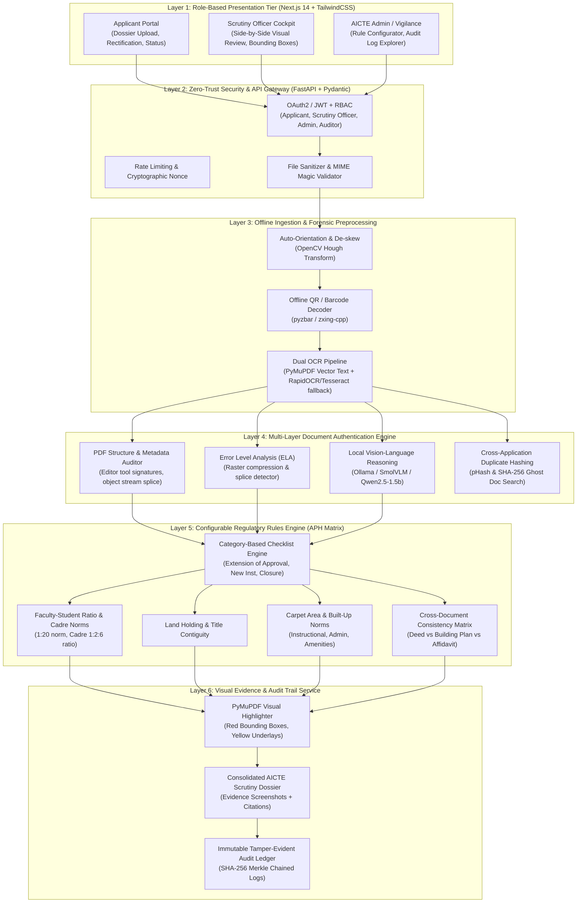
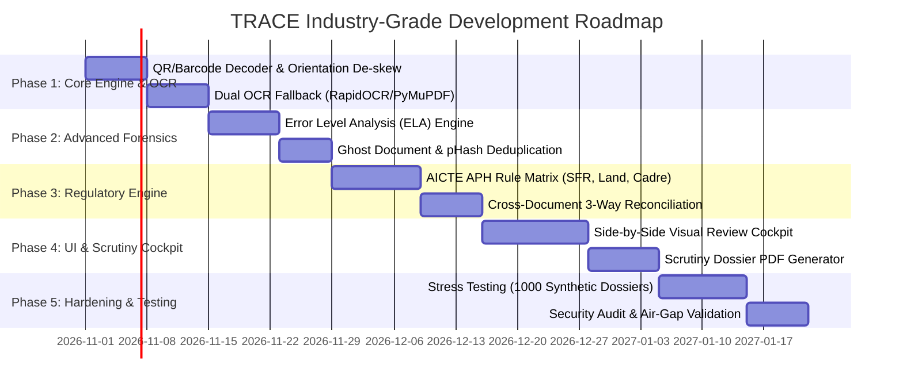

# AICTE TRACE: Industry-Grade Regulatory Compliance & Forensic Document Authentication Platform
**Smart India Hackathon 2026 | Problem Statement ID: 26261 | Organization: AICTE (Regulation Bureau)**

---

## 1. Executive Mission & Strategic Alignment
The **TRACE Platform** (*Trust, Regulatory Authentication, and Compliance Engine*) is an enterprise-grade, offline-capable, decision-support solution designed specifically for the **AICTE Regulation Bureau**. It automates the preliminary screening and fraud detection of Extension of Approval (EoA) application dossiers, authenticates supporting statutory documents, and verifies infrastructure metrics against the **AICTE Approval Process Handbook (APH)**.

### Statutory Ground Rule (PRD §Essential Safeguards)
> **Statutory Notice:** All AI model inferences, tamper flags, and compliance discrepancy alerts are strictly **advisory decision-support signals**. Final administrative authority, physical inspection mandates, and regulatory dispositions remain exclusively vested in competent AICTE Hearing Committees and Regulatory Officers.

---

## 2. Enterprise System Architecture

---

## 3. High-Security & Air-Gapped Compliance Design

To meet government and ministry standards (NIC/CERT-In guidelines for academic regulatory bodies), TRACE implements a multi-tier security boundary:

| Security Vector | Implementation Specification |
| :--- | :--- |
| **Air-Gapped Sovereign AI** | Zero dependency on external cloud APIs (no OpenAI, no Google Gemini cloud, no Anthropic). 100% on-premises execution via local Ollama inference (`qwen2.5:1.5b-instruct` / `smolvlm`) powered by local hardware (e.g., RTX 5060 Laptop GPU). |
| **Zero-Trust Access Control (RBAC)** | Granular permission model: `APPLICANT` (can only view/edit owned draft dossier), `SCRUTINY_OFFICER` (read/annotate assigned applications), `REGULATION_DIRECTOR` (override flags, approve/reject), `VIGILANCE_OFFICER` (view fraud patterns across all state institutes). |
| **Data Encryption & Storage Security** | - **Data-at-Rest:** AES-256 encryption on all stored PDFs and visual screenshots. - **Data-in-Transit:** TLS 1.3 enforced across all API endpoints. - **Upload Sanitization:** Strict magic-byte inspection (disallowing polyglot PDFs, executable payloads, or recursive archive bombs). |
| **Immutable Audit Trail** | Every rule execution, OCR extraction, officer annotation, and status transition is recorded in an immutable audit ledger with user ID, client IP, timestamp, and previous hash chaining (Merkle-style). |
| **Data Privacy & PII Masking** | Aadhaar numbers of faculty are automatically masked to the last 4 digits (`XXXX-XXXX-1234`) in the scrutiny UI to comply with Aadhaar Act data protection regulations. |

---

## 4. Complete Project Blueprint: 6 Core Engineering Workstreams

### Workstream A: Intelligent Ingestion & Multi-Format OCR
* **A1. Auto-Orientation & De-skew**: Automatic 90/180/270-degree rotation correction using text orientation detection so upside-down scans parse seamlessly.
* **A2. Dual-Engine OCR & Layout Parsing**:
  * Digital PDFs: Fast PyMuPDF layout parsing (extracts font families, bounding boxes, text spans).
  * Scanned Images / Low-Res Documents: Offline RapidOCR / Tesseract fallback for scanned land deeds and building blueprints.
* **A3. Native Barcode / QR Code Verifier**: Decodes 2D Barcodes and QR Codes (`pyzbar`) on AICTE EoA certificates and revenue stamps, cross-matching decoded certificate IDs against application text.

### Workstream B: Multi-Layered Anomaly & Tampering Detection
* **B1. PDF Structure & Metadata Forensics**: Flags documents generated by consumer graphics editors (`Canva`, `Photoshop`, `CorelDraw`, `GIMP`) instead of official government scanning suites.
* **B2. Error Level Analysis (ELA)**: Detects compression variance across image patches to uncover digitally spliced signatures, seals, or modified digits.
* **B3. Font & Typography Inconsistency Engine**: Flags text blocks that differ in font size, font family, kerning, or color palette from the surrounding document body.
* **B4. Ghost Document & Duplicate Fingerprinting**: Calculates perceptual hashes (`pHash`) and cryptographic digests (`SHA-256`) to flag certificates reused across different institutions.

### Workstream C: Configurable AICTE APH Regulatory Rules Engine
* **C1. Dynamic Category-Based Checklists**: Automatically assigns required document checklists based on application category:
  * Extension of Approval (EoA)
  * Increase in Approved Intake
  * Introduction of New Courses / Supernumerary Seats
  * Change of Site / Location
* **C2. Faculty-Student Ratio (SFR) & Cadre Verification**: Evaluates compliance against APH Chapter 7 (1:20 for Engineering, 1:15 for Architecture; Cadre Ratio 1 Principal : 2 Professor : 6 Associate : 12 Assistant).
* **C3. Land & Contiguity Verification**: Enforces minimum rural (7.5 acres) vs. urban (2.5 acres) norms and checks that survey numbers are declared contiguous.
* **C4. Cross-Document Reconciliation Engine**: Performs 3-way cross-verification:
  * *Declared Land Area* $\leftrightarrow$ *Sale Deed/Gift Deed* $\leftrightarrow$ *Land Use Certificate*.
  * *Declared Principal Name* $\leftrightarrow$ *Affidavit* $\leftrightarrow$ *Faculty Roster*.

### Workstream D: Default Visual Evidence & Highlight System
* **D1. Automated Vector Highlighting**: Uses PyMuPDF to draw semi-transparent yellow underlays, bold red bounding boxes (`width=2.5`), and warning tags directly on the PDF canvas.
* **D2. Dual-Resolution Evidence Cards**: Automatically outputs both a 2x super-sampled cropped thumbnail for quick scanning and a 150 DPI full-page context overview.
* **D3. Grounded Explanation Engine**: Generates markdown alerts with exact coordinates, violated rule citations, and file line references.

### Workstream E: Verification via Issuing Authority & Digital Repositories
* **E1. Digital Signature Verification**: Offline cryptographic validation of PKCS#7 / PAdES X.509 digital certificates embedded in official PDF documents.
* **E2. Standardized Issuing Authority Adaptor Interface**:
  * Designed mock/live connectors for DigiLocker, State Revenue Portals, and AICTE National Database.
  * Captures 6 standard statuses: `VERIFIED`, `MISMATCH_DETECTED`, `EXPIRED`, `VERIFICATION_PENDING`, `SOURCE_UNAVAILABLE`, `MANUAL_REVIEW_REQUIRED`.

### Workstream F: Scrutiny Officer Cockpit & Dashboard
* **F1. Split-Screen Document Scrutiny View**:
  * Left Panel: Interactive PDF viewer with glowing red bounding boxes over flagged regions.
  * Right Panel: AICTE rule violation summary, extracted fields, and historical baseline records.
* **F2. Human-in-the-Loop Decision Ledger**: Action buttons for Scrutiny Officers:
  * `[Accept Discrepancy (With Justification)]`
  * `[Issue Rectification Notice to Applicant]`
  * `[Refer to Standing Vigilance Committee / Physical Inspection]`
* **F3. One-Click Dossier Export**: Generates an AICTE Scrutiny Dossier PDF containing all visual evidence and compliance matrices for presentation to the Hearing Committee.

---

## 5. Phased Implementation Roadmap

### Phase Details:
1. **Sprint 1 (Weeks 1-2): Ingestion & Optical Upgrades**
   * Integrate QR/Barcode reader (`pyzbar`) and auto-orientation detector to handle scanned image repositories (`f:/TRACE/barcode`, `f:/TRACE/scan_doc_rotation`).
2. **Sprint 2 (Weeks 3-4): Forensics & Tamper Intelligence**
   * Build Error Level Analysis (ELA) filter and cross-application document hash deduplication to catch certificate recycling.
3. **Sprint 3 (Weeks 5-6): Complete AICTE APH Regulatory Matrix**
   * Program all quantitative checks from the latest Approval Process Handbook (SFR, Built-up area norms, land tenure legitimacy).
4. **Sprint 4 (Weeks 7-8): Scrutiny Officer Cockpit & Report PDF Dossier**
   * Build the split-screen web scrutiny cockpit and auto-generate downloadable, court-ready AICTE Scrutiny Dossiers.
5. **Sprint 5 (Weeks 9-10): Stress Testing & Security Certification**
   * Run 1,000-dossier benchmark, perform mock committee presentations, and conduct air-gap security penetration tests.

---

## 6. Key Deliverables & Expected Impact Metrics

| Metric | Traditional Manual Scrutiny | TRACE Platform (Target) |
| :--- | :--- | :--- |
| **Initial Screening Time per Application** | 4 to 6 hours per dossier | **< 3 minutes** (Autonomous) |
| **Detection of Digital Alterations / Splices** | < 15% (Often missed by eye) | **> 90%** (Forensic ELA + Metadata) |
| **Cross-Document Discrepancy Identification** | Prone to human fatigue | **100% Deterministic Consistency** |
| **Scrutiny Transparency & Traceability** | Dispersed physical notes | **100% Auditable Cryptographic Log** |
| **Cloud Dependency / Data Leak Risk** | High if using online SaaS LLMs | **Zero (100% On-Premises & Offline)** |
