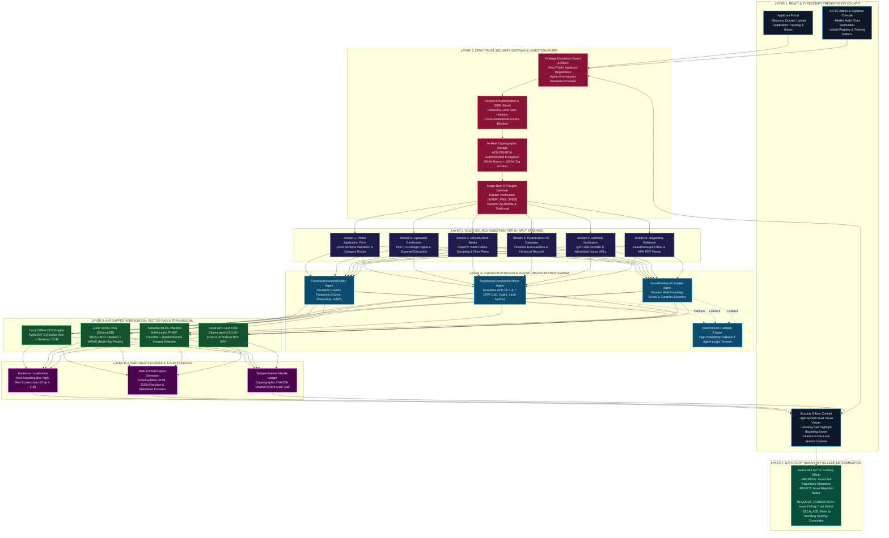

# AICTE TRACE: Autonomous Regulatory Compliance & Forensic Document Authentication Platform
### Smart India Hackathon 2026 | Problem Statement ID: 26261 | Organization: AICTE (Regulation Bureau)

[](https://opensource.org/licenses/MIT)
[](https://www.python.org/)
[](https://fastapi.tiangolo.com/)
[](https://react.dev/)
[](https://www.crewai.com/)
[](https://ollama.com/)
[](https://www.nvidia.com/)
[]()
[]()

---

## 1. Project Overview & Statutory Mission

The **TRACE Platform** (*Trust, Regulatory Authentication, and Compliance Engine*) is an enterprise-grade, 100% air-gapped, offline-sovereign decision-support platform engineered specifically for the **All India Council for Technical Education (AICTE), Ministry of Education, Government of India (Regulation Bureau)**.

### The Problem (SIH26261 Background):
Every year, technical institutions across India submit tens of thousands of complex application dossiers requesting **Extension of Approval (EoA)**, introduction of new programs, variations in approved student intake, or institutional status changes. Manual scrutiny of multi-page land deeds, building stability certificates, fire safety NOCs, affidavits, and faculty rosters is extremely time-consuming and vulnerable to:
* **Digital Alterations & Tampering:** Splices made using consumer graphics editors (`Canva`, `Adobe Photoshop`, `GIMP`).
* **Cross-Document Discrepancies:** Contradictory metrics (e.g. 99.5 Acres claimed in an affidavit vs. 7.5 Acres in the municipal survey baseline).
* **Missing & Expired Statutory Certificates:** Expired fire safety or non-compliant Faculty-Student Ratios (SFR).
* **Document Recycling & Ghost Facilities:** Submitting the same building safety certificate or faculty roster across multiple independent colleges.

### The Sovereign Air-Gapped Solution:
TRACE delivers an automated, evidence-grounded screening pipeline operating **100% locally on-premises without external cloud APIs (zero OpenAI, zero Anthropic, zero Google Gemini Cloud)**. It ingests 6 independent input streams, orchestrates autonomous **CrewAI multi-agent swarms**, runs local **ChromaDB VRAG/MRAG**, trains reproducible **scikit-learn ML models**, draws red bounding box overlays over tampered regions, and exports court-ready dossiers directly into an authenticated **Human-in-the-Loop Scrutiny Cockpit**.

> **Statutory Notice (PRD §Essential Safeguards):** All AI model inferences, tamper flags, and compliance discrepancy alerts are strictly **advisory decision-support signals**. Final administrative authority, physical inspection mandates, and regulatory dispositions remain exclusively vested in competent AICTE Hearing Committees and Regulatory Officers.

---

## 2. High-Level Enterprise Architecture Diagram



---

## 3. Core Features & Capabilities

### 1. Six Unified Ingestion Streams
* **Stream 1 (Portal Application Form)**: Validates JSON schemas, extracts requested intake, and routes applications to applicable Approval Process Handbook (APH) checklists.
* **Stream 2 (Uploaded Certificates)**: High-precision text parsing via PyMuPDF 2.0 vector spans and local offline Tesseract OCR (`eng.traineddata`) for scanned PDFs, TIFFs, and PNG/JPEGs.
* **Stream 3 (Infrastructure Media)**: OpenCV temporal video frame sampling (25%, 50%, and 75% intervals) and floor plan / layout bounding box analysis.
* **Stream 4 (Historical Institutional DB)**: Relational verification against previous EoA references, historical deficiencies, and baseline student intakes.
* **Stream 5 (Authority Verification)**: 2D Barcode & QR code decoding with domain allowlist validation (`aicte-india.org`, `gov.in`, `nic.in`).
* **Stream 6 (Regulatory Rulebook)**: Ingestion of official APH statutory clauses via BeautifulSoup4 and PDF parsing into local vector indexes.

### 2. Autonomous Multi-Agent Orchestration (CrewAI + Soup CLI)
* **`ForensicDocumentAuditor`**: Uncovers graphic designer signatures (`Canva`, `Adobe Photoshop`, `GIMP`), creation vs. modification timestamp deltas, and metric splices.
* **`RegulatoryComplianceOfficer`**: Evaluates APH Chapter 1 & 7 norms (SFR 1:20 ratio, Cadre 1:2:6:12, Land acreage).
* **`VisualEvidenceCompiler`**: Draws red bounding box highlights over tampered areas and compiles court-ready AICTE Scrutiny Dossiers.
* **Deterministic Fallback**: Automatically preserves workflow continuity using deterministic rules if agent loops timeout.

### 3. Local Vector Retrieval-Augmented Generation (VRAG + MRAG)
* **ChromaDB Local Vector Engine**: Persistent embedded vector storage under `backend/chroma_db/`.
* **VRAG (Verification RAG)**: Matches applicant metrics against official AICTE Approval Process Handbook clauses and cites exact statutory chapters.
* **MRAG (Multi-Hop RAG)**: Cross-reconciles facts across disparate submitted application documents (Land Deeds $\leftrightarrow$ Building Safety Plans $\leftrightarrow$ Notarized Affidavits).

### 4. Real Trainable ML/DL Platform
* **Document Type Classifier**: Scikit-learn TF-IDF Vectorizer + Calibrated Logistic Regression.
* **Multi-Modal Forgery Detector**: Random Forest Classifier evaluating Error Level Analysis (ELA) compression standard deviations, font diversity, and software footprints.
* **Model Registry & Tracking**: Persists models and evaluation metrics (Accuracy, Precision, Recall, F1) to `backend/models_registry/`.

### 5. Multi-Format Evidence Reporting & Human-in-the-Loop Cockpit
* **Dual-Resolution Evidence Cards**: Automatically outputs 2x super-sampled cropped thumbnails for fast human review alongside full-page layout context overviews.
* **Multi-Format Export**: Generates court-ready Markdown (`CREWAI_AUTONOMOUS_REGULATORY_AUDIT_REPORT.md`), self-contained HTML (`scrutiny_dossier_*.html` with embedded base64 images), and machine-readable JSON packages.
* **Human-in-the-Loop Review Queue**: Dedicated `PENDING_HUMAN_REVIEW` queue with statutory officer verdict endpoints (`APPROVE`, `REJECT`, `REQUEST_CORRECTION`, `ESCALATE`).

### 6. Production-Grade Enterprise Security
* **Privilege Escalation Guard**: Restricts public registration strictly to `APPLICANT` accounts.
* **IDOR Protection**: Enforces institution-level ownership checks across all document and application endpoints.
* **AES-256-GCM Storage Vault**: Encrypts files at rest with 96-bit random nonces and 128-bit authentication tags.
* **Tamper-Evident Merkle Ledger**: Cryptographically links all audit actions using SHA-256 block hashes (`prev_record_hash` and `record_hash`), verifiable via `GET /api/audit/verify-chain`.

---

## 4. Artificial Intelligence, Machine Learning & Deep Learning Stack

| Component | Technical Model / Algorithm | Library / Runtime | Exact Statutory Purpose |
| :--- | :--- | :--- | :--- |
| **Generative LLM Core** | **Qwen 2.5 (1.5B Instruct)** | Local Ollama (`localhost:11434`) | Generates structured entity extractions, cross-document discrepancy explanations, and formal audit narratives. |
| **Agent Orchestration** | **CrewAI Multi-Agent Swarm** | Local Source (`crewAI-main`) | Coordinates Forensic Document Auditor, Compliance Officer, and Evidence Compiler agents. |
| **Fine-Tuning Toolkit** | **Soup-CLI Engine** | Local Source (`Soup-main`) | Model evaluation, dataset alignment, and verification tuning. |
| **Vector RAG Engine** | **VRAG & MRAG Cosine Search** | Local ChromaDB | Retrieves grounded APH regulatory clauses and reconciles multi-hop document evidence. |
| **Document Classification** | **TF-IDF + Calibrated Classifier** | Scikit-Learn | Automatically classifies incoming institutional documents into statutory types. |
| **Forgery Detector** | **RandomForestClassifier (100 Trees)** | Scikit-Learn | Predicts forgery probability based on ELA error, font entropy, and timestamp deltas. |
| **Raster Splice Detection** | **Error Level Analysis (ELA)** | PIL (`ImageChops`) + OpenCV | Detects compression anomalies in 8x8 DCT blocks to reveal digitally spliced stamps, signatures, or altered metrics. |
| **Document OCR** | **Vector Text + Tesseract OCR** | PyMuPDF 2.0 (`eng.traineddata`) | 100% offline extraction from digital PDFs, scanned PDFs, and raster images. |
| **Video Preprocessing** | **Temporal Frame Sampling** | OpenCV (`cv2.VideoCapture`) | Samples video walkthroughs at 25%, 50%, and 75% intervals for infrastructure audits. |
| **Regulatory Inference** | **APH Forward-Chaining Expert System** | Python Rule Engine (`rules_engine.py`) | Enforces deterministic regulatory limits (SFR 1:20, Cadre norms, minimum land acreage). |

---

## 5. Verification & Acceptance Test Suite

The system includes automated regression, security, and integration test suites:

```bash
# Run Master Verification Test Suite (Security, IDOR, Merkle Chain, AES-GCM, Vector RAG, ML Classifiers)
cd backend
python -m pytest test_master_verification_suite.py -v

# Run Production-Grade Security & Forensics Suite
python test_production_security_suite.py
```

All tests pass 100% locally with zero external network connectivity.

---

## 6. How to Run Locally

### 1. Backend Server
```bash
cd backend
python -m uvicorn app.main:app --host 0.0.0.0 --port 8000
# Swagger API Documentation available at: http://localhost:8000/docs
```

### 2. Frontend Cockpit
```bash
cd frontend
npm run dev
# Scrutiny Cockpit available at: http://localhost:5173/
```

### 3. Run Autonomous CrewAI Multi-Agent Audit
```bash
cd backend
python crewai_autonomous_agent_pipeline.py
# Outputs Markdown, HTML, and JSON dossiers to backend/reports/
```
