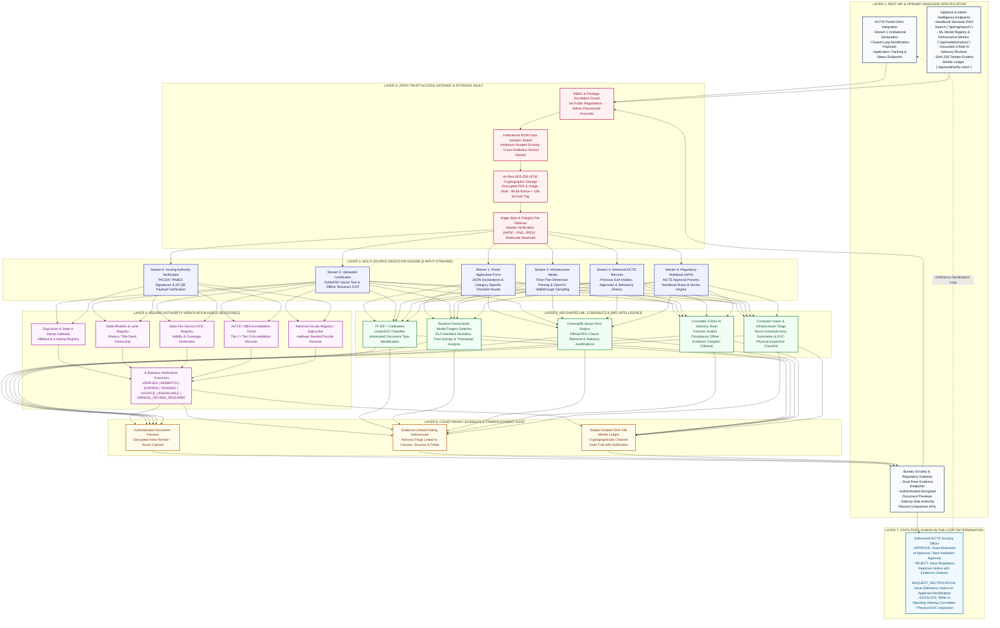

# AICTE TRACE: Autonomous Regulatory Compliance & Forensic Document Authentication Platform
### Smart India Hackathon 2026 | Problem Statement ID: 26261 | Organization: AICTE (Regulation Bureau)

[](https://www.python.org/)
[](https://fastapi.tiangolo.com/)
[](https://ollama.com/)
[]()
[]()

---

## 1. Project Overview & Statutory Mission

The **TRACE Platform** (*Trust, Regulatory Authentication, and Compliance Engine*) is an enterprise-grade, 100% air-gapped, offline-sovereign decision-support platform engineered specifically for the **All India Council for Technical Education (AICTE), Ministry of Education, Government of India (Regulation Bureau)** in direct alignment with **SIH Problem Statement 26261**.

### The Problem (SIH 26261 Background):
Every year, technical institutions across India submit tens of thousands of complex application dossiers requesting **Extension of Approval (EoA)**, introduction of new programs, variations in approved student intake, or institutional status changes. Manual scrutiny of multi-page land deeds, building stability certificates, fire safety NOCs, affidavits, and faculty rosters is extremely time-consuming and vulnerable to:
* **Digital Alterations & Tampering:** Splices and digital manipulation made using consumer graphics editors (`Canva`, `Adobe Photoshop`, `GIMP`).
* **Cross-Document Discrepancies:** Contradictory metrics across documents (e.g., 99.5 Acres claimed in an affidavit vs. 7.5 Acres in the municipal survey baseline).
* **Missing & Expired Statutory Certificates:** Expired fire safety certificates, land lease expiries, or non-compliant Faculty-Student Ratios (SFR).
* **Difficulty in Confirmation from Issuing Authorities:** Slow or inconclusive manual verification with state registries and issuing portals.

### The Sovereign Air-Gapped Solution:
TRACE delivers an automated, evidence-grounded screening pipeline operating **100% locally on-premises without external cloud APIs**:
1. **Multi-Source Ingestion (6 Streams):** Ingests portal declarations, certificate files (PDF/PNG/JPEG), infrastructure floor plans and walkthrough videos (OpenCV frame sampling), historical AICTE databases, official issuing-authority verification gateways, and Approval Process Handbook (APH) regulatory rules.
2. **Multi-Channel Issuing Authority Hub:** Connects to 5 statutory issuing registries (`DIGILOCKER_ESTAMP`, `STATE_BHULEKH`, `FIRE_PORTAL`, `AICTE_NBA_PORTAL`, `FACULTY_REGISTRY`), inspects PDF PKCS#7/PAdES digital signatures, and decodes QR code payloads, mapping results into all 6 statutory states (`VERIFIED`, `MISMATCH`, `EXPIRED`, `PENDING`, `SOURCE_UNAVAILABLE`, `MANUAL_REVIEW_REQUIRED`).
3. **Forensic & Machine Learning Inspection:** Employs Error Level Analysis (ELA), scikit-learn TF-IDF document classification, Random Forest forgery detection, and PyMuPDF vector span parsing, with an authenticated, decrypted document preview (`/api/documents/{id}/preview`).
4. **Local Vector RAG & Grounded AI Review:** Indexes official APH clauses in ChromaDB for semantic retrieval, paired with an offline 3-role AI advisory review team running on local Ollama (`qwen2.5:1.5b-instruct`).
5. **Closed-Loop Rectification Workflow:** Allows applicants to view identified deficiencies, upload missing or replacement certificates, amend declared metrics, and resubmit; a reviewer then re-runs validation before final administrative action.
6. **Standalone Enterprise Headless Backend API:** A robust, high-performance RESTful API architecture providing OpenAPI/Swagger interactive endpoints, automated JSON scrutiny packages, and zero frontend dependencies for seamless integration into any client portal.

> **Statutory Safeguard (PRD & SIH 26261):** All AI inferences, tamper alerts, and compliance flags are strictly **advisory decision-support signals**. Statutory scrutiny, physical inspections where required, and final regulatory determinations remain exclusively with competent AICTE authorities.

---

## 2. End-to-End Enterprise System Architecture



---

## 3. Technology Stack & Packages

### Backend (Python 3.14 Air-Gapped Environment)
| Category | Library / Tool | Exact Role in Platform |
| :--- | :--- | :--- |
| **Framework & API** | `fastapi`, `uvicorn`, `starlette` | High-performance asynchronous REST API runtime |
| **Data Validation & Settings** | `pydantic`, `pydantic-settings` | Request/response schema validation and environment management |
| **Database & ORM** | `sqlmodel`, `sqlalchemy` | Relational SQLite / PostgreSQL ORM with automatic schema migrations |
| **Cryptography & Security** | `cryptography`, `bcrypt`, `pyjwt` | AES-256-GCM file encryption, password hashing, and JWT tokens |
| **Document Processing & OCR** | `pymupdf` (PyMuPDF / fitz), `pypdf` | Vector text extraction, PDF metadata analysis, and annotated PNG page rendering |
| **Computer Vision & Forensics** | `opencv-python`, `pillow`, `scipy` | ELA compression analysis, QR code decoding, and video frame sampling |
| **Vector Database & RAG** | `chromadb` | Embedded vector database for AICTE Approval Process Handbook semantic search |
| **Machine Learning** | `scikit-learn`, `joblib`, `numpy` | Document classification (TF-IDF + Calibrated LinearSVC) and Forgery Detection (Random Forest) |
| **Local LLM Inference** | `ollama` (`qwen2.5:1.5b-instruct`) | Local on-premises structured advisory analysis without cloud APIs |
| **Testing & Quality Assurance**| `pytest`, `pytest-asyncio` | Automated security, verification, and regression test suites |

---

## 4. Key Functional Modules & Endpoints

### 1. Multi-Channel Issuing Authority Hub
- **Service:** `backend/app/services/issuing_authority_hub.py`
- Connects documents to authoritative registries:
  - `DIGILOCKER_ESTAMP`: e-Stamp certificate verification.
  - `STATE_BHULEKH`: Land record title and Khasra validation.
  - `FIRE_PORTAL`: State fire safety NOC validity checks.
  - `AICTE_NBA_PORTAL`: Course accreditation status.
  - `FACULTY_REGISTRY`: Faculty verification against authorized databases.
- Evaluates **PDF PKCS#7 / PAdES digital signatures** and **2D QR payloads**.
- Returns one of the 6 statutory verification outcomes: `VERIFIED`, `MISMATCH`, `EXPIRED`, `PENDING`, `SOURCE_UNAVAILABLE`, `MANUAL_REVIEW_REQUIRED`.

### 2. Authenticated Document Preview
- **Endpoint:** `GET /api/documents/{document_id}/preview`
- Decrypts the stored AES-256-GCM file in memory and returns the original document inline (`Cache-Control: no-store`, `X-Content-Type-Options: nosniff`).
- Access follows the document's own scoping: applicants see only their institution's documents.

### 3. Golden Dossiers & Seed Records
- **Service:** `backend/app/services/golden_dossiers_service.py`
- Seeds four comprehensive prototype dossiers covering major AICTE regulatory workflows:
  1. `AICTE-2026-EOA-GOLD-A`: Extension of Approval with verified NOCs and compliance.
  2. `AICTE-2026-NEW-GOLD-B`: New Institution application with fire NOC mismatch and land acreage deficiency.
  3. `AICTE-2026-INC-GOLD-C`: Increase in Intake with expired fire certificate and building plan review.
  4. `AICTE-2026-EOA-GOLD-D`: Extension of Approval with unresolved land dispute and manual review requirements.

### 4. Grounded 3-Role AI Advisory Review
- **Endpoint:** `POST /api/applications/{application_id}/agent-review`
- Executes a multi-perspective advisory review using local Ollama:
  - **Forensic Document Auditor:** Analyzes document metadata, alterations, and digital integrity.
  - **Regulatory Compliance Officer:** Compares declared metrics with APH requirements retrieved from ChromaDB.
  - **Evidence Compiler:** Synthesizes observations and compiles physical inspection (EVC) recommendations.

### 5. Closed-Loop Rectification
- Available while the application is `RECTIFICATION_REQUESTED`.
- **Endpoints:**
  - `POST /api/documents/{document_id}/rectify`: Uploads a replacement for a current document; the old one is kept as superseded.
  - `POST /api/documents/upload`: Uploads a document type that has **no** current document (e.g. to answer "document missing"); a type that already has one must be replaced through `rectify` (`409` otherwise).
  - `POST /api/applications/{application_id}/submit-rectification`: Merges amended declared metrics and returns the application to `SUBMITTED`. It does not run validation itself; a reviewer re-runs `POST /api/applications/{application_id}/validate`.

---

## 5. Verification & Acceptance Testing

The backend suite lives in `backend/tests/` and runs against a temporary SQLite database built by the Alembic migrations (no Ollama, ChromaDB or network needed); the frontend suite runs with Vitest.

```bash
cd backend && uv run python -m pytest -q          # backend/tests/
cd frontend && npm test                            # Vitest (src/**/*.test.ts[x])
```

### Backend suite (`backend/tests/`)
| File | Covers |
| :--- | :--- |
| `test_auth.py`, `test_tokens.py` | Login, lockout and rate limiting, access/refresh tokens, rotation and reuse detection, password change |
| `test_admin_users.py` | Admin user management, e-mail normalisation, the `create-admin` CLI |
| `test_authorization.py` | Role matrix and institution (IDOR) isolation for every endpoint |
| `test_lifecycle.py`, `test_rectification.py` | Application lifecycle (submit, validate, decision), rectification and uploads |
| `test_validation.py` | Validation flags (current/superseded), category-scoped checklist rules, compliance parsing |
| `test_audit_chain.py` | HMAC-chained audit log, tamper detection, concurrent writers |
| `test_documents_storage.py` | AES-256-GCM storage, magic-byte and size checks, filename sanitisation, preview, ELA |
| `test_dashboard.py` | Dashboard metrics and model registry |
| `test_config.py`, `test_http.py`, `test_execution_surface.py` | Settings validation; security headers, CORS and error handling; model pinning and AI availability |
| `test_migrations.py`, `test_repo_hygiene.py` | Alembic migrations, ignored/tracked files and dependencies |
| `test_master_verification_suite.py` | Cross-cutting acceptance checks (no public registration, IDOR, audit chain, storage, ML/RAG, authority hub) |

---

## 6. How to Run Locally

### Prerequisites
- Python 3.14 with [uv](https://docs.astral.sh/uv/), and Node.js 20+.
- (Optional) Local Ollama on `http://localhost:11434` for AI review. When Ollama is down, `POST /api/applications/{id}/agent-review` returns `503`.
- (Optional) The `ai` extra for the CrewAI / LangGraph / ChromaDB features: `uv sync --extra ai`.

### 1. Configure and migrate the backend
```bash
cd backend
uv sync
cp .env.example .env
uv run python -m app.cli generate-keys     # prints SECRET_KEY, AUDIT_HMAC_KEY, FILE_ENCRYPTION_KEY; paste into .env
```
For local HTTP development also set these in `backend/.env`:
```ini
ENVIRONMENT=development
COOKIE_SECURE=false
```
Create the schema and the first administrator (the password is prompted, 12-128 characters):
```bash
uv run python -m alembic upgrade head
uv run python -m app.cli create-admin --email admin@example.org --full-name "Site Admin"
```
A local `backend/aicte_platform.db` created before the Alembic migrations (by an older version of this project) must be **deleted** and then recreated with the two commands above (`alembic upgrade head`, then `create-admin`). Do not try to adopt it into the migrations: it still holds the old seeded demo accounts and passwords.

### 2. Run the API and the frontend
```bash
uv run python -m uvicorn app.main:app --host 127.0.0.1 --port 8000   # backend/
npm install && npm run dev                                          # frontend/, http://127.0.0.1:3000
```
The Vite dev server proxies `/fastapi-proxy` to `http://localhost:8000` (override with `TRACE_API_ORIGIN`). Sign in as the admin and use **Users** to create reviewer and applicant accounts; new users must change their temporary password at first sign-in. There are no built-in demo accounts.

### 3. Onboard an institution
An applicant account must be linked to an institution, and institutions are created by an admin through the API. Sign in to obtain an access token, then `POST /api/institutions` with the `InstitutionCreate` fields:
```bash
TOKEN=$(curl -s -X POST http://127.0.0.1:8000/api/auth/login \
  -d "username=admin@example.org" --data-urlencode "password=<admin password>" \
  | python -c "import json,sys; print(json.load(sys.stdin)['access_token'])")

curl -s -X POST http://127.0.0.1:8000/api/institutions \
  -H "Authorization: Bearer $TOKEN" -H "Content-Type: application/json" \
  -d '{
        "aicte_permanent_id": "1-1234567890",
        "name": "Example Institute of Technology",
        "state": "Maharashtra",
        "district": "Pune",
        "address": "1 College Road, Pune 411001",
        "established_year": 2010,
        "historical_records": {}
      }'
```
`aicte_permanent_id` must be unique (`400` otherwise); `historical_records` is optional (previous EoA reference, approved intake, etc.). The response carries the institution `id`. Then create the institution's applicant accounts with that institution: in **Users**, or `POST /api/admin/users` with `"role": "applicant", "institution_id": <id>`. `GET /api/institutions` lists existing institutions.

### 4. Production notes
See [`frontend/README.md`](frontend/README.md) section 4 (same-origin reverse proxy, cookie path, forwarded IPs). Before going live also check:
- **Request body limit:** set the reverse proxy's upload limit (e.g. nginx `client_max_body_size`) to about `MAX_UPLOAD_MB` (default 25 MB) so oversized uploads are refused at the edge.
- **Back up `FILE_ENCRYPTION_KEY` and `AUDIT_HMAC_KEY`** (secretly, alongside the database backups). Losing `FILE_ENCRYPTION_KEY` makes every stored document unreadable; losing or changing `AUDIT_HMAC_KEY` makes the audit chain unverifiable (`verify-chain` reports `BROKEN`).
- **Content-Security-Policy for the SPA:** serve the built frontend with a CSP (e.g. `default-src 'self'; object-src 'none'; frame-ancestors 'none'; base-uri 'self'`, adding `frame-src`/`img-src` `blob:` if documents are previewed from blob URLs); the API's security headers do not cover the static files.
- **Purge expired refresh tokens:** rows in `refresh_tokens` are kept after they expire or are revoked; delete expired rows periodically (e.g. a daily `DELETE FROM refresh_tokens WHERE expires_at < CURRENT_TIMESTAMP`).

### 5. Tests
```bash
cd backend && uv run python -m pytest -q
cd frontend && npm test && npm run lint && npm run build
```
