# AICTE TRACE: Enterprise Architecture Blueprint
**Smart India Hackathon 2026 | Problem Statement ID: 26261 | Organization: AICTE (Regulation Bureau)**  
**System Classification:** High-Security Air-Gapped Sovereign AI Decision-Support Platform  

---

## 1. High-Level Enterprise Architecture Diagram

```mermaid
graph TB
    %% STYLING DIRECTIVES
    classDef clientLayer fill:#1E293B,stroke:#38BDF8,stroke-width:2px,color:#F8FAFC;
    classDef securityLayer fill:#881337,stroke:#FB7185,stroke-width:2px,color:#FFF1F2;
    classDef ingestionLayer fill:#14532D,stroke:#4ADE80,stroke-width:2px,color:#F0FDF4;
    classDef forensicLayer fill:#312E81,stroke:#818CF8,stroke-width:2px,color:#EEF2FF;
    classDef rulesLayer fill:#78350F,stroke:#FBBF24,stroke-width:2px,color:#FFFBEB;
    classDef aiLayer fill:#0C4A6E,stroke:#38BDF8,stroke-width:2px,color:#F0F9FF;
    classDef evidenceLayer fill:#4A044E,stroke:#E879F9,stroke-width:2px,color:#FDF4FF;
    classDef decisionLayer fill:#064E3B,stroke:#34D399,stroke-width:2px,color:#ECFDF5;

    %% LAYER 1: CLIENT PRESENTATION TIER
    subgraph L1 ["LAYER 1: ROLE-BASED PRESENTATION TIER (Web & Scrutiny Cockpit)"]
        direction TB
        C1["Applicant Portal<br/>- Dossier Upload & Validation Status<br/>- 15-Day Cure Notice Rectification UI"]:::clientLayer
        C2["Scrutiny Officer Cockpit<br/>- Split-Screen Visual PDF Viewer<br/>- Glowing Red Highlight Bounding Boxes<br/>- Rule Violation & Evidence Inspector"]:::clientLayer
        C3["AICTE Vigilance Dashboard<br/>- Cross-Institution Fraud Correlation<br/>- Ghost Document Fingerprint Matrix"]:::clientLayer
    end

    %% LAYER 2: SECURITY & ZERO-TRUST GATEWAY
    subgraph L2 ["LAYER 2: ZERO-TRUST SECURITY GATEWAY & INGESTION FILTER"]
        direction TB
        S1["Identity & RBAC Engine<br/>OAuth2 / JWT Authentication<br/>(Applicant, Scrutiny Officer, Admin, Auditor)"]:::securityLayer
        S2["True-MIME Magic Byte Sanitizer<br/>Header Verification (%PDF-, PNG, JPEG)<br/>Disarms Polyglot PDFs & Zip Bombs"]:::securityLayer
        S3["At-Rest Cryptographic Vault<br/>AES-256-GCM Authenticated Encryption<br/>(96-bit Nonce + 128-bit Auth Tag)"]:::securityLayer
        S4["Statutory Privacy Guard<br/>Aadhaar (XXXX-XXXX-1234) & PAN Obfuscation<br/>Compliant with Aadhaar Act Norms"]:::securityLayer
    end

    %% LAYER 3: INGESTION & CV PREPROCESSING
    subgraph L3 ["LAYER 3: MULTI-MODAL INGESTION & CV PREPROCESSING"]
        direction TB
        I1["Auto-Orientation & De-skew<br/>OpenCV Hough Line Transform<br/>Corrects 90/180/270 Scanned Rotations"]:::ingestionLayer
        I2["2D Barcode & QR Code Engine<br/>OpenCV QRCodeDetector<br/>Extracts Issuing Authority Digital Signatures"]:::ingestionLayer
        I3["Dual-Engine Layout Parser<br/>PyMuPDF 2.0 Vector Text & Font Spans<br/>+ Offline RapidOCR Raster Fallback"]:::ingestionLayer
    end

    %% LAYER 4: MULTI-LAYER FORENSICS ENGINE
    subgraph L4 ["LAYER 4: MULTI-LAYER DOCUMENT AUTHENTICATION ENGINE"]
        direction TB
        F1["Structure & Metadata Auditor<br/>Detects Consumer Editor Footprints<br/>(Canva, Photoshop, GIMP, Ilovepdf)"]:::forensicLayer
        F2["Error Level Analysis (ELA)<br/>8x8 DCT Compression Delta Analysis<br/>Exposes Spliced Stamps & Numbers"]:::forensicLayer
        F3["Perceptual Image Hashing (dHash)<br/>64-bit Gradient Hash Invariant to Scale<br/>Cross-Institutional Document Deduplication"]:::forensicLayer
        F4["Probabilistic Forensics Scorer<br/>Calibrated Multi-Feature Ensemble<br/>Eliminates Artificial 100% Overfitting"]:::forensicLayer
    end

    %% LAYER 5: REGULATORY COMPLIANCE MATRIX
    subgraph L5 ["LAYER 5: CONFIGURABLE AICTE APH REGULATORY RULES ENGINE"]
        direction TB
        R1["Dynamic Category Checklists<br/>EoA, New Institution, Intake Variation,<br/>Change of Site, Closure Norms"]:::rulesLayer
        R2["Faculty-Student Ratio & Cadre<br/>APH Ch 7: 1:20 Ratio Enforcement<br/>Cadre Balance (1 Principal : 2 Prof : 6 Assoc : 12 Asst)"]:::rulesLayer
        R3["Land Area & Title Contiguity<br/>Rural (7.5 Acres) vs Urban (2.5 Acres)<br/>Contiguous Parcel Validation"]:::rulesLayer
        R4["3-Way Cross-Reconciliation<br/>Land Deed ↔ Building Safety Plan ↔ Affidavit<br/>Cross-Verification with AICTE Portal Baseline"]:::rulesLayer
    end

    %% LAYER 6: AIR-GAPPED LOCAL AI INFERENCE CORE
    subgraph L6 ["LAYER 6: AIR-GAPPED LOCAL AI INFERENCE CORE"]
        direction TB
        A1["Local LLM Runtime (Ollama Core)<br/>Qwen 2.5 (1.5B / 3B Instruct Models)<br/>100% Offline / Zero Cloud API Calls"]:::aiLayer
        A2["Hardware Acceleration Engine<br/>NVIDIA GeForce RTX Laptop GPU<br/>PyTorch 2.14 + CUDA 13.0 Active"]:::aiLayer
        A3["Multi-Modal Vision-Language (VLM)<br/>SmolVLM / Qwen2-VL Model<br/>Physical Rubber Stamp & Ink Bleed Reasoning"]:::aiLayer
        A4["Regulatory Scrutiny Synthesizer<br/>Generates Evidence-Linked Explanations<br/>and Scrutiny Officer Action Directives"]:::aiLayer
    end

    %% LAYER 7: VISUAL EVIDENCE & AUDIT TRAIL
    subgraph L7 ["LAYER 7: VISUAL EVIDENCE & AUDIT TRAIL SERVICE"]
        direction TB
        E1["PyMuPDF Vector Annotator<br/>Draws Red Bounding Boxes (width=2.5)<br/>+ Semi-Transparent Yellow Underlays"]:::evidenceLayer
        E2["Dual-Resolution Evidence Cards<br/>2x Super-Sampled Cropped Highlight Cards<br/>+ 150 DPI Full-Page Context Overviews"]:::evidenceLayer
        E3["Tamper-Evident Audit Ledger<br/>SHA-256 Merkle-Chained Event Ledger<br/>Immutable Verification Trail"]:::evidenceLayer
        E4["Consolidated AICTE Dossier Generator<br/>Default Evidence-Linked Markdown Dossier<br/>and Court-Ready PDF Compilation"]:::evidenceLayer
    end

    %% STATUTORY DECISION LAYER
    subgraph L8 ["FINAL REGULATORY DISPOSITION (Human-in-the-Loop)"]
        direction TB
        DEC["AICTE Standing Committee / Scrutiny Officers<br/>- Accept Discrepancy (With Justification)<br/>- Issue 15-Day Show Cause Notice<br/>- Refer to Vigilance Committee / Physical Inspection"]:::decisionLayer
    end

    %% PIPELINE INTERCONNECTS
    C1 & C2 & C3 --> S1
    S1 --> S2 --> S3 --> S4
    S4 --> I1 --> I2 --> I3
    I3 --> F1 & F2 & F3 & F4
    F4 --> R1
    R1 --> R2 & R3 & R4
    R4 --> A1
    A1 --> A2 --> A3 --> A4
    A4 --> E1 --> E2 --> E3 --> E4
    E4 --> C2
    C2 --> DEC
```

---

## 2. Layer-by-Layer Architectural Specifications

### Layer 1: Role-Based Presentation Tier (Web & Cockpit)
* **Target Audience:** Technical Institution Applicants, AICTE Scrutiny Officers, Regional Directors, and Standing Vigilance Committee Members.
* **Component Architecture:**
  * **Applicant Portal:** Drag-and-drop dossier ingestion, file type categorization, real-time completeness progress bar, and deficiency cure submission interface.
  * **Scrutiny Officer Cockpit:** High-visibility split-screen interface displaying the original uploaded PDF on the left (with interactive red bounding boxes) and the AICTE rule violation summary on the right.
  * **Vigilance Matrix:** Cross-institutional forensic map highlighting ghost documents, duplicated survey numbers, and shared faculty across independent colleges.

### Layer 2: Zero-Trust Security Gateway & Ingestion Filter
* **Guiding Principle:** Defense-in-depth compliant with **NIC / CERT-In** sovereign data standards.
* **Security Controls:**
  * **Strict Role-Based Access Control (RBAC):** Tokenized OAuth2/JWT authentication enforcing separation of duties (`APPLICANT`, `SCRUTINY_OFFICER`, `VIGILANCE_OFFICER`, `REGULATION_DIRECTOR`).
  * **Magic-Byte Polyglot Defense:** Validates binary headers (`%PDF-`, `\x89PNG`, `\xff\xd8\xff`) to neutralize executable scripts hidden inside uploaded documents.
  * **At-Rest Authenticated Encryption:** AES-256-GCM encryption with unique per-file 96-bit random nonces; files are never written unencrypted to physical storage.
  * **Statutory PII Redaction:** Protects personal privacy by masking Aadhaar numbers to the final 4 digits (`XXXX-XXXX-1234`) and obfuscating PAN strings (`ABCDE****F`).

### Layer 3: Multi-Modal Ingestion & CV Preprocessing
* **Purpose:** Normalizes incoming statutory instruments regardless of scan quality, skew, or origin.
* **Processing Modules:**
  * **Auto-Orientation & De-skew:** OpenCV Hough Line transform calculates the skew angle ($\theta \in [-90^\circ, 0^\circ]$) to automatically rotate crooked documents upright before text parsing.
  * **2D Barcode & QR Code Engine:** Native OpenCV `QRCodeDetector` extracts digital signatures, issuing authority URLs, and encrypted reference hashes from government certificates.
  * **Dual-Engine Layout Parser:** PyMuPDF 2.0 extracts vector layout hierarchy, font styles, and bounding boxes; offline RapidOCR serves as fallback for purely rasterized scans.

### Layer 4: Multi-Layer Document Authentication Engine
* **Purpose:** Uncovers digital alterations, synthetic splices, and cross-application document recycling.
* **Forensic Vectors:**
  * **Metadata & Object Stream Auditing:** Flags documents created or modified using consumer design suites (`Canva`, `Adobe Photoshop`, `CorelDraw`, `GIMP`, `Ilovepdf`) instead of government scanner drivers.
  * **Error Level Analysis (ELA):** Recompresses image patches at fixed quality (90%) and evaluates 8x8 DCT compression error distributions ($\sigma_{\text{err}}$); digitally pasted seals and cloned text blocks show distinct compression variance.
  * **Perceptual Image Hashing (dHash):** Computes 64-bit structural gradient hashes invariant to contrast and slight recompression to detect recycled certificates across institutions.
  * **Calibrated Probabilistic Scorer:** Weighted multi-metric ensemble calibrated against real-world test sets to prevent artificial 100% binary model overfitting.

### Layer 5: Configurable AICTE APH Regulatory Rules Engine
* **Purpose:** Deterministic statutory validation against the **AICTE Approval Process Handbook (APH)**.
* **Statutory Checks:**
  * **Dynamic Category Checklists:** Contextual checklist evaluation based on application type (Extension of Approval, New Institution, Intake Variation, Change of Site).
  * **Faculty-Student Ratio (SFR) & Cadre Norms:** Enforces APH Chapter 7 (1:20 norm for Engineering; Cadre Balance: 1 Principal : 2 Professor : 6 Associate : 12 Assistant).
  * **Land Area & Title Contiguity:** Enforces minimum acreage (Rural: 7.5 acres, Urban: 2.5 acres) and validates contiguous parcel registration.
  * **3-Way Cross-Document Reconciliation:** Matches metrics across Title Deeds $\leftrightarrow$ Building Safety Plans $\leftrightarrow$ Notarized Affidavits $\leftrightarrow$ Institutional Portal Baselines.

### Layer 6: Air-Gapped Local AI Inference Core
* **Purpose:** Sovereign, offline language and vision inference without external cloud API dependencies.
* **Inference Pipeline:**
  * **Local LLM Runtime:** Local Ollama core running `qwen2.5:1.5b-instruct` / `qwen2.5-coder:3b` models via local REST endpoints (`localhost:11434`).
  * **Hardware Acceleration:** Hardware-accelerated inference powered by local NVIDIA GeForce RTX Laptop GPU via PyTorch CUDA.
  * **Multi-Modal Vision AI (VLM):** SmolVLM / Qwen2-VL for reasoning over physical stamp boundaries, rubber seal ink bleeding, and signature legitimacy.
  * **Scrutiny Narrative Synthesizer:** Transforms detected anomalies into formal, evidence-linked regulatory summaries for the Hearing Committee.

### Layer 7: Visual Evidence & Audit Trail Service
* **Purpose:** Converts complex analytical detections into clear visual evidence for human decision-makers.
* **Output Artifacts:**
  * **Vector Bounding Box Highlighter:** PyMuPDF overlays bold red bounding frames (`stroke=(0.9, 0.1, 0.1)`, `width=2.5`), yellow highlight underlays, and warning flags directly onto PDF coordinates.
  * **Dual-Resolution Evidence Cards:** Generates 2x super-sampled cropped highlight cards alongside 150 DPI full-page context overviews.
  * **Tamper-Evident Merkle Ledger:** Chained SHA-256 block ledger logging every user action, rule evaluation, and status transition.
  * **Default Scrutiny Dossier:** Automatically outputs the complete visual audit report ([`TRACE_ALL_FLAGGINGS_AUDIT_REPORT.md`](file:///f:/TRACE/AI-Powered-Application-Validation-Doc-Authentication-and-Regulatory-Compliance-Verification-Platform-main/backend/reports/TRACE_ALL_FLAGGINGS_AUDIT_REPORT.md)).

---

## 3. Statutory Human-in-the-Loop Decision Layer

In strict accordance with the **Essential Safeguards** of SIH Problem Statement 26261:
1. **Advisory Decision-Support Only:** The AI engine does not make binding adverse regulatory rulings. Every flag is marked as advisory (`is_advisory=True`).
2. **Hearing Committee Prerogative:** Only authorized AICTE Scrutiny Officers and Hearing Committees possess the legal mandate to:
   * **Accept Explanations:** Clear flags if the institution provides legitimate justification.
   * **Issue 15-Day Cure Notice:** Request rectified documentation for incomplete fields.
   * **Refer to Standing Vigilance Committee:** Order on-site physical inspections where document tampering or land discrepancies are confirmed.
