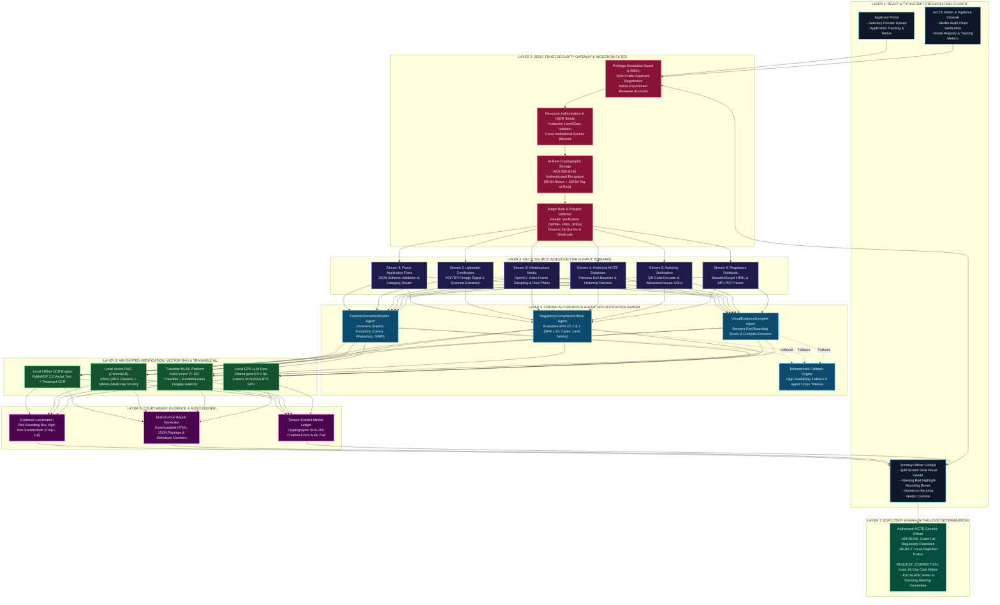

# AICTE TRACE: Enterprise Architecture Blueprint & Technical Specification
**Smart India Hackathon 2026 | Problem Statement ID: 26261 | Organization: AICTE (Regulation Bureau)**  
**System Classification:** High-Security Air-Gapped Sovereign AI Decision-Support Platform  

---

## 1. High-Level Enterprise Architecture Diagram

---

## 2. Subsystem Architecture Specifications

### 2.1 Layer 1: React & TypeScript Presentation Cockpit
- **Technology Stack**: React 18, TypeScript, Vite 5, Vanilla CSS Design System with Glassmorphism and Lucide icons.
- **Portals**:
  - **Applicant Portal**: Submits multi-stream packets, monitors OCR progress, views required documents checklist.
  - **Scrutiny Officer Cockpit**: Interactive split-screen review, dual-resolution bounding box evidence viewer, one-click CrewAI agent audit trigger, human-in-the-loop verdict buttons (`APPROVE`, `REJECT`, `REQUEST_CORRECTION`, `ESCALATE`).
  - **Admin & Vigilance Dashboard**: Monitors cryptographic Merkle audit chain verification status, inspects ML training metrics, and analyzes cross-institutional ghost certificate recycling.

### 2.2 Layer 2: Zero-Trust Security Gateway
- **Privilege Escalation Protection**: Public registration can only create `APPLICANT` accounts. Administrative and reviewer accounts require authenticated authorization.
- **In-Depth IDOR Mitigation**: Validates institutional ownership on application retrieval, document uploads, document listing, and verification triggering.
- **Cryptographic Storage**: AES-256-GCM authenticated encryption at rest with 96-bit random nonces and 128-bit authentication tags.
- **Magic-Byte Polyglot Defense**: Validates headers (`%PDF-`, `PNG`, `JPEG`) to neutralize polyglot files, shellcode, and decompression bombs.

### 2.3 Layer 3: Six Input Streams Ingestion Tier
1. **Stream 1 (Portal Application Form)**: Validates JSON declarations, resolves category (EoA, New Institution, Intake Increase), and generates dynamic checklists.
2. **Stream 2 (Uploaded Certificates)**: Extracts digital vector text and executes offline Tesseract OCR on scanned instruments.
3. **Stream 3 (Infrastructure Media)**: Samples video frames at 25%, 50%, and 75% intervals using OpenCV, verifying temporal continuity and room/floor plans.
4. **Stream 4 (Historical Institutional DB)**: Queries previous EoA baselines, historical deficiencies, and authorized student intake figures.
5. **Stream 5 (Authority Verification)**: Decodes 2D QR codes and verifies against allowlisted government domains (`aicte-india.org`, `gov.in`, `nic.in`).
6. **Stream 6 (Regulatory Rulebook)**: Parses official APH regulatory clauses from PDFs and HTML using BeautifulSoup4.

### 2.4 Layer 4: Autonomous CrewAI Multi-Agent Swarm
- **`ForensicDocumentAuditor`**: Uncovers graphic designer signatures (`Canva`, `Adobe Photoshop`, `GIMP`), timestamp modifications, and metric splices.
- **`RegulatoryComplianceOfficer`**: Enforces AICTE APH Chapter 1 & 7 norms (SFR 1:20 ratio, Cadre 1:2:6:12, Land acreage).
- **`VisualEvidenceCompiler`**: Localizes anomalies with vector bounding boxes and compiles comprehensive scrutiny dossiers.
- **Deterministic Fallback**: Automatically activates deterministic rules engine if agent loops encounter timeouts or constrained hardware.

### 2.5 Layer 5: Air-Gapped Verification, Vector RAG & Machine Learning
- **PyMuPDF + Tesseract OCR**: Native vector extraction for digital PDFs; embedded Tesseract OCR (`eng.traineddata`) for scanned PDFs and raster images.
- **Local ChromaDB Vector RAG**: Persistent local embeddings for VRAG (statutory APH clauses) and MRAG (multi-hop document reconciliation).
- **Trainable ML/DL Subsystem**: Scikit-learn TF-IDF Document Classifier and Random Forest multi-modal Forgery Detector with precision, recall, and F1 tracking.
- **Local GPU Inference Core**: Ollama running `qwen2.5:1.5b-instruct` on NVIDIA GeForce RTX GPU.

### 2.6 Layer 6: Court-Ready Evidence & Audit Ledger
- **Visual Evidence Cards**: Dual-view screenshots (Micro-Zoom Highlight with red bounding frame + Macro Layout Context).
- **Multi-Format Export**: Generates court-ready Markdown (`CREWAI_AUTONOMOUS_REGULATORY_AUDIT_REPORT.md`), self-contained HTML (`scrutiny_dossier_*.html` with embedded base64 images), and machine-readable JSON packages.
- **Tamper-Evident Merkle Ledger**: Persists `prev_record_hash` and `record_hash` on every action, providing end-to-end cryptographic verification via `GET /api/audit/verify-chain`.

### 2.7 Layer 7: Statutory Human-in-the-Loop Determination
- **In Accordance with SIH Problem Statement 26261 Essential Safeguards**, AI agents are strictly advisory decision-support tools.
- **Only an authenticated AICTE Scrutiny Officer** can finalize approval or rejection decisions, with all determinations recorded in the tamper-evident audit ledger.
